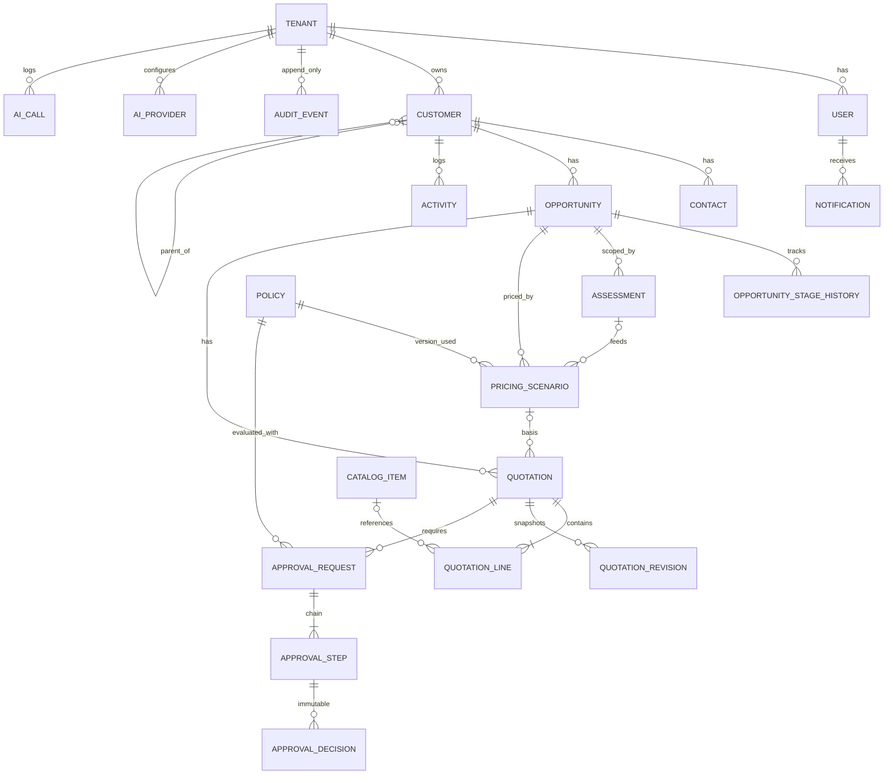
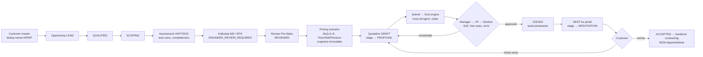

# ERD & Process Flow

## 1. ERD Phase 1 (terimplementasi)

Semua tabel transaksi memiliki `tenant_id`, `created_at`, aktor, dan kunci UUID. Tabel bertanda append-only dijaga trigger `forbid_mutation()`: `audit_events`, `approval_decisions`, `quotation_revisions`, `pricing_scenarios`, `ai_calls`.

### Entitas Phase 2–5 (direncanakan, belum dibuat)
Tender, TenderRequirement, Vendor, PriceList, FlexGuardWallet, WalletTransaction (ledger immutable, reversal-only), ServiceRequest, Proposal, Document, Contract, Acceptance, Project, ResourceAllocation, Timesheet, Deliverable, Invoice, Payment, Partner, SupportTicket, Renewal.

## 2. Alur Phase 1 (end-to-end yang sudah berjalan)

| Tahap | Owner | Entry | Exit | Audit |
|---|---|---|---|---|
| Customer | Account Manager | — | Customer unik tersimpan | `customer.create` |
| Scoping | Pre-Sales | Opportunity SCOPING | Assessment REVIEWED | `assessment.calculate/review` |
| Pricing | Pre-Sales/Finance | Assessment REVIEWED | Scenario tersimpan (syarat stage PROPOSAL) | `pricing.scenario_saved` |
| Quotation | Account Manager | Scenario | Submit | `quotation.create/update/submit` |
| Approval | Manager/VP/Direktur | IN_APPROVAL | APPROVED/REJECTED/REVISION | `approval.*` + `approval_decisions` |
| Issue & send | Account Manager | APPROVED (versi sama) | SENT | `quotation.issue/sent` |
| Acceptance | Customer user | SENT, masih berlaku | ACCEPTED → contracting | `portal.quotation_*` |
