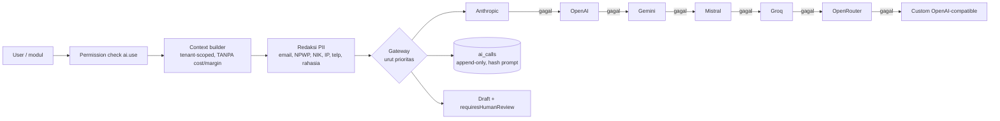

# Security Architecture, Threat Model & AI Gateway

## 1. Kontrol yang sudah terimplementasi (Phase 1)

| Ancaman | Kontrol | Bukti uji |
|---|---|---|
| Broken access control / IDOR | Semua query difilter `tenant_id` dari token server-side; permission dicek `requirePerm` di setiap route | E2E `[#13]` tenant lain → 404 |
| Kebocoran biaya/margin | Field-level redaction (`redactQuotation`, `redactPrice`), portal hanya status SENT+ milik customer sendiri | E2E `[#14]`, UI smoke |
| Approval palsu dari UI | `decide()` memverifikasi role, level, step, SoD, four-eyes, `row_version` dalam transaksi `FOR UPDATE` | E2E `[#4]` |
| Manipulasi histori | Trigger append-only pada audit, keputusan, revisi, scenario, ai_calls | E2E `[#16]` UPDATE/DELETE ditolak |
| Double submit / replay | `Idempotency-Key` + unique open approval per entitas | E2E `[#17]` |
| Brute force | Rate limit login 10/menit/IP, lockout 5x gagal → 15 menit, timing equalisation | E2E lockout |
| Session theft | JWT 8 jam + `token_version` (dicabut saat ganti password / logout-all), cek user aktif tiap request | — |
| Password lemah | bcrypt cost 12, min 12 char + kompleksitas, wajib ganti saat login pertama | E2E |
| Injection | Parameterized query (`postgres` tagged template), Zod validation di semua body | — |
| XSS di dokumen | Escape HTML, CSP `default-src 'none'` pada surat penawaran, iframe sandbox | — |
| Kredensial pelanggan di scoping | Penolakan field `password/secret/credential` | E2E `[#2]` |
| Clickjacking/sniffing | `X-Frame-Options: DENY`, `nosniff`, helmet | — |

## 2. Gap keamanan terbuka (wajib sebelum produksi)

1. MFA untuk role privileged (Direktur, VP, admin) — Phase 5.
2. Token di `sessionStorage` → pindah ke cookie httpOnly via BFF — Phase 5.
3. Enkripsi kolom sensitif (NPWP, data teknis) + KMS — Phase 2.
4. File upload scanning (MinIO) — belum ada upload di Phase 1.
5. SAST/DAST + dependency scanning di CI (stage `security` sudah disiapkan di `.gitlab-ci.yml`, aturan blocking belum diaktifkan).
6. Backup terenkripsi + uji restore (acceptance #18) — belum diuji.
7. Rate limit masih in-memory per instance → Redis saat multi-instance.

## 3. AI Gateway — multi-provider failover

- Provider dilewati bila: nonaktif, env API key kosong, atau circuit breaker OPEN (3 gagal berturut → 60 detik).
- Timeout per provider (default 30 s, konfigurabel). 429/5xx/401/timeout/network → lanjut ke provider berikutnya.
- API key **hanya** di environment server (`ANTHROPIC_API_KEY`, `OPENAI_API_KEY`, `GEMINI_API_KEY`, `MISTRAL_API_KEY`, `GROQ_API_KEY`, `OPENROUTER_API_KEY`, `CUSTOM_LLM_API_KEY` + `CUSTOM_LLM_BASE_URL`). DB hanya menyimpan nama env var.
- Prompt-injection defence: konten user/dokumen dibungkus `<document>`/`<context>` dan system prompt menyatakan isinya data, bukan instruksi; AI tidak punya tool yang mengubah data.
- Log `ai_calls` menyimpan SHA-256 prompt (bukan isi), provider, latensi, token, jumlah redaksi, jejak percobaan.
- Model ID default dapat diubah dari halaman *Kebijakan & AI* atau env `AI_MODEL_<PROVIDER>`. **Verifikasi nama model ke dokumentasi masing-masing provider sebelum go-live** — nama model berganti cepat.
- "Custom" menampung endpoint OpenAI-compatible lain (Ollama/vLLM/cloud lokal) — dipakai bila "Opencloud" yang dimaksud adalah layanan semacam itu.
